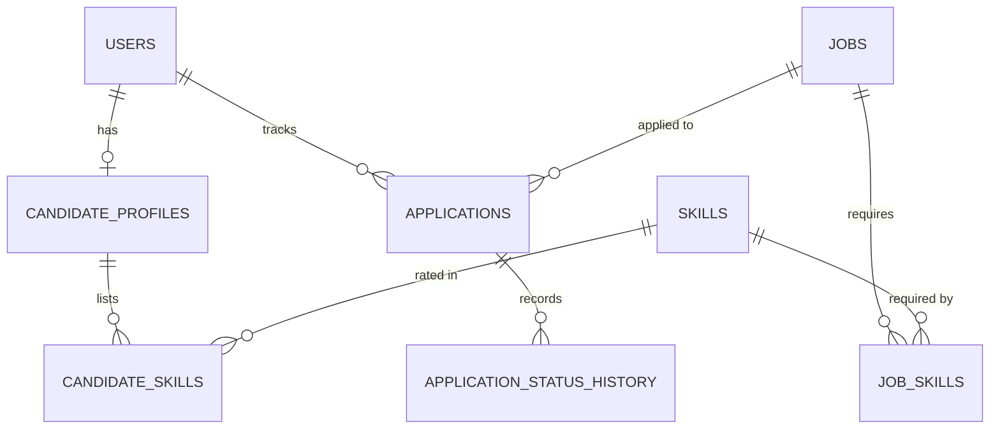
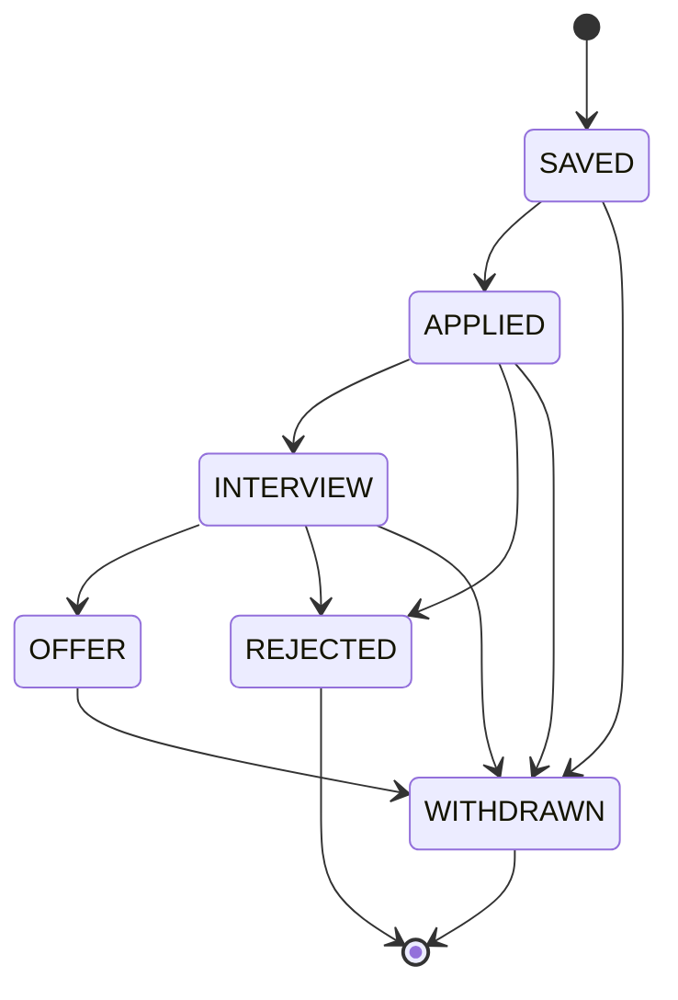

# ApplyFlow

[](https://github.com/Smlv05/applyflow/actions/workflows/ci.yml)

Backend for tracking a job search. You describe your skills, import vacancies, see which ones fit you best (and which skills you are missing for each), and track every application from "saved" to "offer".

I built it as a portfolio project. I work as a QA automation engineer, so I paid more attention to the things I usually test: what happens on duplicate requests, on parallel requests, on bad input, and on someone else's data. The test suite runs against a real PostgreSQL, both locally and in CI.

## What it does

- Registration and login with JWT. Two roles, `USER` and `ADMIN`.
- Candidate profile with skills and a level for each one (beginner to expert).
- Job import from pluggable providers. Right now there is one mock provider with eight sample jobs; a real job board can be added by implementing one interface.
- Job search by text, location, remote, skill and minimum salary, with pagination.
- Recommendations: jobs sorted by how well they match your skills, with the matched and missing skills listed for each.
- Applications with a fixed status flow (`SAVED`, `APPLIED`, `INTERVIEW`, `OFFER`, `REJECTED`, `WITHDRAWN`) and a history of every change.
- Statistics: how many applications are in each status, and what share of applications reached an interview or an offer.
- Swagger UI for trying the API.

## Stack

Java 21, Spring Boot 4.1, Spring Security (JWT), Spring Data JPA with Hibernate, PostgreSQL 17, Flyway, springdoc-openapi, JUnit, Mockito, Testcontainers, Maven, Docker Compose, GitHub Actions.

## Running it

You need JDK 21 and Docker.

```bash
docker compose up -d
./mvnw spring-boot:run        # on Windows: .\mvnw.cmd spring-boot:run
```

Then open http://localhost:8080/swagger-ui.html.

To call protected endpoints there: run `POST /api/auth/register`, then `POST /api/auth/login`, copy the `accessToken` from the response, click **Authorize** and paste it (without the word `Bearer`).

The JWT secret has a development default in `application.yml`. For anything other than local use, set the `JWT_SECRET` environment variable to a string of at least 32 characters.

### Importing jobs

Only admins can import. New accounts are always `USER`, so to try it locally, promote your account in the database and log in again (the role is stored in the token):

```bash
docker exec -it applyflow-postgres psql -U applyflow -d applyflow \
  -c "UPDATE users SET role = 'ADMIN' WHERE email = 'you@example.com'"
```

After that, `POST /api/jobs/import` loads the sample jobs. Running it again does nothing, because jobs are matched by source and external id.

## API

| Method | Path | |
|---|---|---|
| POST | `/api/auth/register` | create an account |
| POST | `/api/auth/login` | get a token |
| GET | `/api/users/me` | current user |
| GET | `/api/skills` | list of known skills |
| GET, PUT | `/api/profile` | read or update your profile |
| POST | `/api/profile/skills` | add a skill or change its level |
| DELETE | `/api/profile/skills/{skillId}` | remove a skill |
| POST | `/api/jobs/import` | import jobs (admin only) |
| GET | `/api/jobs` | search: `q`, `location`, `remote`, `skill`, `minSalary`, `page`, `size` |
| GET | `/api/jobs/{id}` | one job |
| GET | `/api/jobs/recommended` | jobs ranked for your profile: `minScore`, `page`, `size` |
| POST | `/api/applications` | save a job as an application |
| GET | `/api/applications` | your applications, optional `status` filter |
| GET | `/api/applications/{id}` | one application with its history |
| PATCH | `/api/applications/{id}/status` | change the status |
| GET | `/api/applications/stats` | counts and conversion rates |

Every error has the same shape, including 401 and 403 from the security layer:

```json
{
  "timestamp": "2026-10-13T08:00:00Z",
  "status": 409,
  "error": "INVALID_STATUS_TRANSITION",
  "message": "Cannot change application status from SAVED to OFFER",
  "fieldErrors": {}
}
```

## Notes on the implementation

### Structure

The code is split by feature (`auth`, `user`, `candidate`, `skill`, `job`, `matching`, `application`), and each feature has a controller, a service and a repository. Entities never leave the service layer; the API uses DTO records.



### How the match score works

Each skill a job requires counts if you have it, and the weight depends on your level: beginner 0.25, intermediate 0.5, advanced 0.8, expert 1.0. The score is the sum of those weights divided by the number of required skills, times 100. A job with no listed skills gets 0. Skill names are compared ignoring case.

The scoring itself is a plain function behind the `MatchScorer` interface, with no database access, so it is easy to test and to replace. Before scoring, the database returns only the jobs that share at least one skill with your profile.

### Application statuses



The allowed transitions are defined in the `ApplicationStatus` enum. The only way to change a status is `Application.changeStatus()`, which checks the transition and writes a history row. An illegal change returns `409`.

### A few choices worth mentioning

- Rules that matter are also enforced by the database: unique indexes (email ignoring case, job source plus external id, one application per user per job), foreign keys and check constraints.
- Duplicates are handled by catching the unique-constraint violation instead of "check, then insert", so parallel requests cannot create two rows. There are tests that send parallel requests to check this.
- On login with an unknown email, the app still does a BCrypt comparison against a dummy hash, so the response time does not tell whether an email is registered.
- The schema is owned by Flyway migrations, and Hibernate runs with `ddl-auto: validate`. If an entity and a table disagree, the app does not start.
- Another user's application returns `404`, not `403`, so its existence is not revealed.
- Lists load related data in batches to avoid one query per row, and open-in-view is off.

## Tests

```bash
./mvnw verify
```

There are 100+ tests. Unit tests cover services, the scorer, the status transitions (every allowed and forbidden pair) and the statistics. Integration tests start the whole application with MockMvc and a PostgreSQL 17 container from Testcontainers, and cover authorization, validation errors, pagination, ranking and parallel requests. Docker has to be running.

GitHub Actions runs `./mvnw -B verify` on every push and pull request. I work on feature branches and merge through pull requests.

## Next

- Benchmarks and load tests (JMH for the scorer, k6 for search and recommendations) with before/after numbers for query optimizations.
- Notes on how I use AI tools while developing this project: [docs/ai-workflow](docs/ai-workflow/AI-LOG.md).
- A real job board provider.

## Author

Ersultan Ismailov